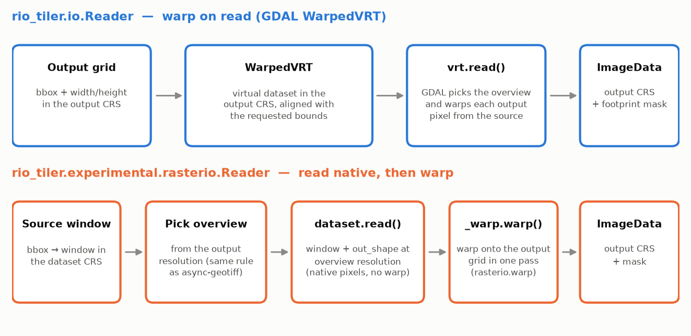
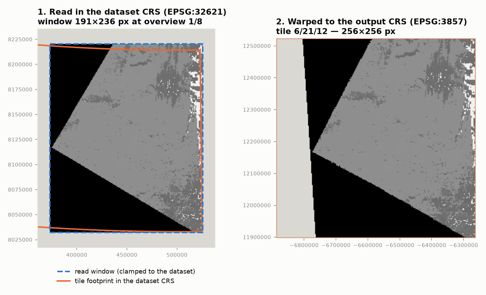
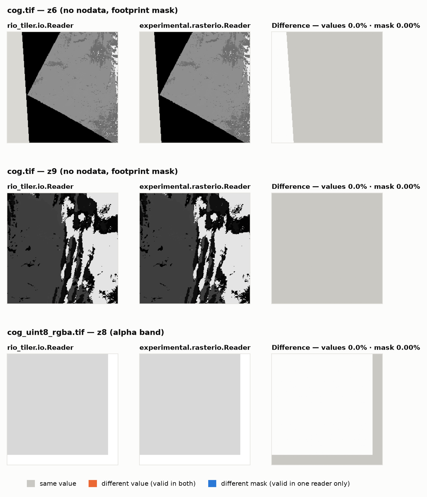
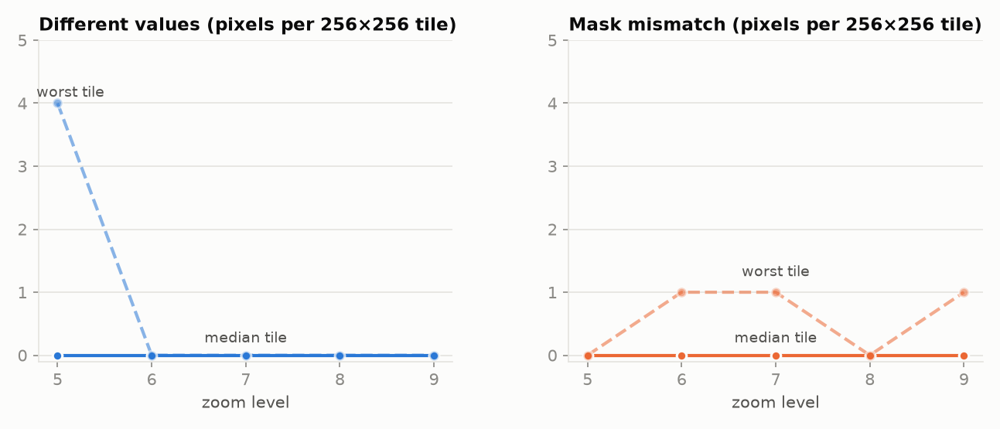

# Rasterio Reader (read, then warp)

`rio_tiler.experimental.rasterio.Reader` is a drop-in variant of `rio_tiler.io.Reader` that **does not use GDAL's `WarpedVRT`**. It reads the native pixels in the dataset's CRS and then reprojects/resamples them in memory, exactly like the [async-geotiff reader](async-geotiff.md) does.

```python
from rio_tiler.experimental.rasterio import Reader

with Reader("tests/fixtures/cog.tif") as src:
    img = src.tile(21, 12, 6)
    img = src.part((-61.0, 73.0, -60.0, 74.0), max_size=512)
    img = src.preview(max_size=1024)
    pt = src.point(-60, 73)
```

Opening the dataset (including datasets with GCPS), `info()` and `feature()` are inherited from `rio_tiler.io.Reader`. All the data access methods (`read`, `tile`, `part`, `preview`, `point`, `statistics`) are re-implemented.

## Two philosophies

The idea was first sketched in [cogeotiff/rio-tiler#656](https://github.com/cogeotiff/rio-tiler/pull/656): instead of creating a `WarpedVRT` aligned with the requested output and reading from it, do the *inverse*: compute the part to read in the dataset CRS, read it, then reproject it to the output CRS.



### `rio_tiler.io.Reader`: warp on read

1. Define the output grid (bounds + width/height in the output CRS).
2. Create a `WarpedVRT` aligned with that grid.
3. `vrt.read()`: GDAL selects the overview and, for **each output pixel**, maps it back to the source and samples it.

Everything happens inside GDAL, in a single resampling pass. This is accurate and feature-complete (`vrt_options`, `padding`, `align_bounds_with_dataset`, ...), but the logic is a black box that only exists in GDAL. A reader that doesn't use GDAL to fetch data (e.g. `async-geotiff`, Zarr) can't reproduce it.

### `rio_tiler.experimental.rasterio.Reader`: read native, then warp

1. Transform the requested bounds to the dataset CRS and build the **source window**.
2. **Pick the overview** matching the output resolution, with **GDAL's rule** (`rio_tiler._warp.get_overview_level`, shared with the async-geotiff and GeoZarr readers): the most downsampled overview whose downsampling factor is lower than `desired factor × threshold`. The threshold is `1.2` for `nearest` (an overview up to ~1.2× coarser than the output can be used) and `1.0` for other resampling methods (an overview coarser than the output is never used), The threshold can be set with the `RIO_TILER_OVERVIEW_OVERSAMPLING_THRESHOLD` environment variable; when not set, GDAL's `GDAL_OVERVIEW_OVERSAMPLING_THRESHOLD` is used if defined, so both readers keep picking the same overview. The desired factor is computed like `rio_tiler.io.Reader` does (`rio_tiler._warp.get_downsampling_factor`): for a reprojection, from the `WarpedVRT` size at the dataset resolution in the output CRS.
3. `dataset.read(window, out_shape=...)`: read the **native pixels** at the overview resolution. This is plain I/O: there is no warping. Because rasterio can't open an overview as a dataset, we request an `out_shape` matching the overview resolution, which makes GDAL read directly from that overview. Like GDAL, we consider that the overview covers the full dataset extent: its pixel size is `width / overview_width` full resolution pixels (e.g. `2658 / 167 = 15.92` for a `1/16` overview), not exactly the decimation factor, so the window can have fractional offsets.
4. `rio_tiler._warp.warp()`: warp the native pixels directly onto the output grid, in memory, in a single `rasterio.warp.reproject` pass. Like `rio_tiler.io.Reader`, the kernel is `reproject_method` when the CRS changes and `resampling_method` otherwise.

The read step and the warp step are decoupled. The *same* algorithm is shared with the async-geotiff reader, so the two produce the same output, and the read step can be replaced by any backend that can fetch a window of pixels.



The left panel shows what is actually fetched for tile `6/21/12`: a rectangular window (dashed blue) at overview `1/8`, in the dataset CRS (`EPSG:32621`). The window is the bounding box of the tile footprint (orange) and is clamped to the dataset extent. The right panel shows the result once warped to `EPSG:3857`.

## Visual differences

The images below compare tiles read with both readers from the test fixtures. The third column highlights the pixels that differ:

- **orange**: the pixel is valid in both outputs, but the value is different
- **blue**: the pixel is valid in one output and masked in the other



The outputs are (almost) identical. Both readers pick the same overview (same rule, same desired factor) and warp its pixels directly onto the output grid, in a single pass (for `nearest`, GDAL's `WarpedVRT` warps the selected source overview straight onto the requested buffer). The remaining differences are:

1. **Footprint edges.** For a dataset without nodata/mask, the `WarpedVRT` mask is the warped footprint of the dataset. The experimental reader computes it from the reprojection of the native window. The two can disagree on a single edge pixel.
2. **Lowest zoom.** With `nearest`, a few pixels (< 0.1%) can resolve to a neighbor value.

The per-zoom agreement for `cog.tif` (all the tiles covering the dataset, from minzoom to maxzoom):



| zoom | tiles | different values in pixels (median / worst tile) | mask mismatch in pixels (median / worst tile) |
| ---: | ----: | -----------------------------------------------: | --------------------------------------------: |
| 5    | 4     | 0 / 4                                            | 0 / 0                                         |
| 6    | 6     | 0 / 0                                            | 0 / 1                                         |
| 7    | 16    | 0 / 0                                            | 0 / 1                                         |
| 8    | 49    | 0 / 0                                            | 0 / 0                                         |
| 9    | 170   | 0 / 0                                            | 0 / 1                                         |

Except for 4 pixels in one z5 tile (99.97% identical), the values are identical in every tile, and the masks differ by at most one edge pixel per tile. With `bilinear` and `cubic` resampling, the values are identical in every tile. For `cog_nodata.tif` (nodata mask), values and masks are identical in every tile, for the three resampling methods.

!!! note

    For a read in the dataset CRS (no reprojection) with `bilinear` or `cubic` resampling, values can still differ when the output resolution is within a few percent of an overview resolution: both readers read the same overview, but `rio_tiler.io.Reader` resamples it with GDAL's RasterIO while the experimental reader uses GDAL's warper, and the two kernels differ slightly at a ~1:1 scale.

!!! warning "`reproject_method` other than `nearest`"

    The numbers above use the default `reproject_method="nearest"`. With `reproject_method="bilinear"` (or `cubic`), reprojected tiles can differ slightly from `rio_tiler.io.Reader` when the warp downsamples. The [async-geotiff reader](async-geotiff.md) gives exactly the same numbers: the difference comes from the shared `rio_tiler._warp.warp`, not from the read step.

    **Why.** Both readers read the same overview and GDAL runs the same warp kernel, but GDAL's output depends on how the warp is split into chunks. When downsampling with `bilinear` or `cubic`, GDAL widens the kernel (anti-aliasing) and sets it up for each chunk from that chunk's source window. `rio_tiler.io.Reader` warps the whole overview in `WarpedVRT` blocks (e.g. two 256×128 chunks for a 256×256 tile), while `rasterio.warp.reproject` warps a window of it in its own chunks (e.g. 128×128 and 64×64). A `WarpedVRT` over the whole overview reproduces `rio_tiler.io.Reader` exactly, but a window of it doesn't, even when padded, so exact parity isn't possible with a "read a window, then warp" approach. With `nearest` there is no widened kernel and the outputs are identical.

    **How much.** The gap is largest when `resampling_method` is also `bilinear`/`cubic`: GDAL's overview rule then picks a finer overview, so the warp downsamples more. For `cog.tif` with both methods set to `bilinear`, the median tile is 66% identical at zoom 5, 90% at zoom 7 and 100% at zoom 9 (no downsampling). The differences are small: most differing pixels are within ±1, and the mean absolute difference is 0.9% of the mean value at zoom 5 and 0.06% at zoom 8 (up to 1.2% for `cubic` at zoom 5). With `reproject_method="bilinear"` and `resampling_method="nearest"`, the median tile is 98.7% identical or more.

These numbers are checked in `tests/test_experimental_rasterio.py::test_reader_tile_footprint`, and the figures above are generated with `uv run --with matplotlib python docs/scripts/experimental_rasterio/experimental_rasterio_figures.py`. Other tests in that file check that tiles from datasets with nodata, an internal mask or an alpha band have identical masks, and that `read()`, `preview()` and `point()` return the same values as `rio_tiler.io.Reader`.

## Behavior differences

|                                    | `rio_tiler.io.Reader`                          | `rio_tiler.experimental.rasterio.Reader`                           |
| ---------------------------------- | ---------------------------------------------- | ------------------------------------------------------------------ |
| Warping                            | GDAL `WarpedVRT`, one pass                     | native read + `rasterio.warp.reproject`, one pass (two for `gauss`) |
| Overview selection                 | GDAL                                           | GDAL's rule, implemented in rio-tiler (shared with async-geotiff and GeoZarr readers) |
| `part()` / `feature()` output size | from the `WarpedVRT` transform                 | estimated from the bounds in the dataset CRS (e.g. 334×1024 vs 348×1024 for the same feature) |
| `buffer`                           | ✅                                              | ✅                                                                  |
| `padding`, `vrt_options`, `align_bounds_with_dataset`, `minimum_overlap` | ✅ | ❌ ignored, with a `UserWarning`                                    |
| `options`                          | all low-level reader options                   | only `nodata` and `unscale`                                        |
| `part()` with a non-intersecting bbox | returns a fully masked image                | raises `ValueError("Input BBOX and dataset's bounds do not intersect")` |
| `point(..., out_dtype=...)` with an alpha band | point is masked                    | alpha band is read in its native dtype, so the point stays valid   |

## Pros and cons

### Pros

- **Same pixels as `rio_tiler.io.Reader`.** Same overview selection, same overview geometry and a single warp pass: tiles are identical to the ones from `rio_tiler.io.Reader` (except for a footprint edge pixel), for `nearest`, `bilinear` and `cubic` resampling, with the default `reproject_method="nearest"`.
- **Fast zoomed-out tiles for reprojected datasets.** The reader never builds a `WarpedVRT` at the dataset's native resolution. Mask and single-band reads can't fall into GDAL's slow block-by-block warp path, which can cost seconds of CPU per band on a large COG at low zoom. Each read is a window from a source overview, and the warp runs in memory on that small array.
- **One algorithm across backends.** Overview selection, window computation and warping are shared with the [async-geotiff reader](async-geotiff.md), so both readers return the same output. The read step can be replaced by any backend able to fetch a window of pixels.
- **Explicit overview selection.** The overview is chosen in rio-tiler (`rio_tiler._warp.get_overview_level`, same rule as GDAL), not by GDAL's warper, which makes it easier to test and debug.
- **Predictable reads.** Only a window clamped to the dataset is read, at overview resolution, with no warping in the read itself. Below the dataset's `minzoom`, only the coarsest overview is read.
- **Bounded memory.** `rio_tiler._warp.warp` processes the output in chunks of up to 2048×2048 pixels.
- **Mask reads skipped when possible.** When the mask comes from a nodata value, it is built from the data and the dataset mask is never read.
- **Drop-in API.** Same methods and signatures as `rio_tiler.io.Reader`. Opening the dataset (including datasets with GCPS), `info()` and `feature()` are inherited.

### Cons

- **Not strictly pixel-identical to `rio_tiler.io.Reader`.** Footprint masks can differ by an edge pixel, and `bilinear`/`cubic` values can differ for reads in the dataset CRS at a ~1:1 scale (see [Visual differences](#visual-differences)).
- **`reproject_method` other than `nearest` differs slightly.** When the warp downsamples with `bilinear` or `cubic`, GDAL's anti-aliased output depends on how the warp is chunked, which can't be reproduced from a window of the overview. On `cog.tif`, with both methods set to `bilinear`, the median tile is 66% (zoom 5) to 90% (zoom 7) identical, with a mean absolute difference under 1% of the mean value (same gap as the async-geotiff reader, see [Visual differences](#visual-differences)).
- **`gauss` resampling takes two steps.** GDAL's warper has no `gauss` kernel, so with `resampling_method="gauss"` (and no reprojection) the data is warped at native resolution, then resized to the output shape.
- **Different output size for `part()` / `feature()`.** The output size is estimated from the bounds in the dataset CRS, so the output shape can differ from `rio_tiler.io.Reader` for the same request.
- **Missing options.** `padding`, `vrt_options`, `align_bounds_with_dataset` and `minimum_overlap` are ignored (with a warning), and only `nodata` and `unscale` are taken from `options`.
- **Datasets with GCPS still use a `WarpedVRT`.** They are opened through a `WarpedVRT` at native resolution. If they have no nodata value, the masks are still read through the VRT.
- **Assumed overview shape.** The overview size is assumed to be `ceil(size / decimation)` (GDAL's convention when building overviews) rather than read from the file. If the real overview size differs, GDAL resamples it to that shape.
- **Less battle-tested.** Datasets crossing the antimeridian, polar projections and inverted-latitude datasets have limited test coverage, and performance has only been compared on a few datasets.
